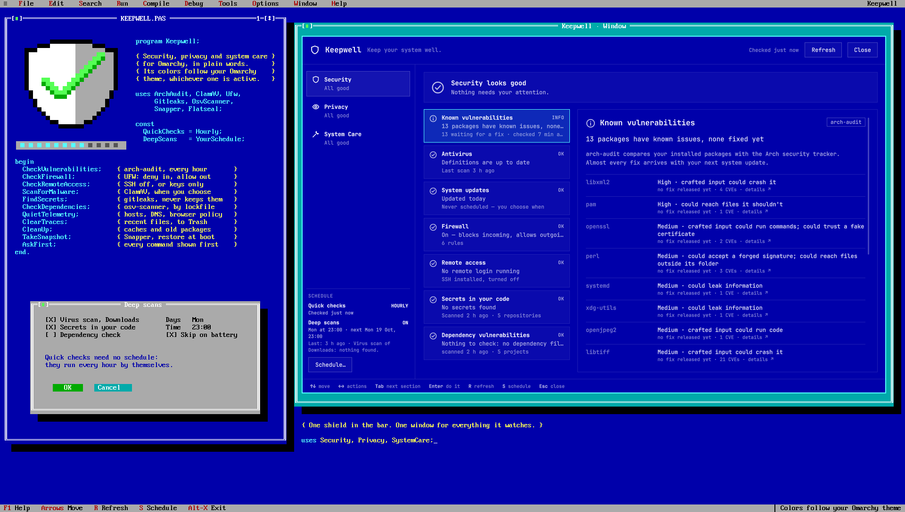

# Keepwell

*Keep your system well.*



An Omarchy shell plugin that brings security, privacy and system care into one
window, for people new to Linux. Keepwell is a frontend and a coordinator, not
a toolkit: wherever a maintained tool already does the job (ClamAV, UFW,
arch-audit, Flatseal, Snapper…), Keepwell shows its state in plain language and
hands you to it. The full design is in [docs/keepwell-spec.md](docs/keepwell-spec.md).

> **Status: 1.0.0.** Every check reads your real system and every action
> works. The quick checks run by themselves (at login and hourly) and notify
> you when something newly needs attention; the deep scans — virus, secrets,
> dependencies — run when you ask or on a schedule you choose.

## What it looks like

- A shield in the bar: a plain outline when all is well, a dot when something
  wants a look, an exclamation mark when something needs action.
- Click it (or run `omarchy-shell keepwell toggle`) to open the window:
  Privacy, Security and System Care in a rail on the left, a one-line summary
  of the section, the list of checks, and the selected check explained.

Status is shown by shape and word, never by colour alone, so it reads the same
under every theme:

| State   | Shape          | Word    |
|---------|----------------|---------|
| Act now | octagon ✕      | ACT NOW |
| Review  | triangle !     | REVIEW  |
| OK      | circle ✓       | OK      |
| Info    | circle i       | INFO    |
| Off     | dashed circle  | OFF     |

All colours, fonts, spacing and corner rounding come from the active Omarchy
theme.

### Keyboard

| Key           | Does                          |
|---------------|-------------------------------|
| ↑ ↓ / j k     | move through checks           |
| ← → / h l     | move through a check's actions|
| Tab / Shift+Tab | next / previous section     |
| Enter         | run the selected (or primary) action |
| R / F5        | Refresh: run every quick check again now |
| S             | Schedule: quick checks and the deep-scan schedule |
| M / D         | run / dismiss a missed scheduled scan |
| Esc           | leave the actions, then close |

## Installing

```bash
omarchy plugin add https://github.com/keasbeexd/omarchy-keepwell.git --enable
```

The bar icon lands on the right of the bar; move it with
`omarchy bar move keasbeexd.keepwell --section <left|center|right>`.

## IPC

The plugin registers one IPC target, `keepwell`, with parameterless methods
only: `show`, `hide`, `open`, `close`, `toggle` open and close the window, and
`refresh` re-runs the read-only local check (a finished scan calls it, so the
result is already showing when you open Keepwell). Nothing else.

```bash
omarchy-shell keepwell toggle
```

## When checks run

**Quick checks** — every check in the window except the deep scans — need
no schedule: they're always on, running once every hour, and also:

- when the shell starts (at login), and **every hour** while you're logged
  in — arch-audit included (see Network);
- when you open the window, if the last result is more than a minute old
  (the local checks; arch-audit's last result is shown with its time);
- when you press **Refresh** (or **R** / **F5**) — always, however recent the last
  check, arch-audit included — after an action's terminal closes, and when
  a background scan ends.

They take about a second, only read, and change nothing. When a check newly
needs attention (Review or Act now), the shield changes and Keepwell sends
one notification for it — once, until it clears. This is the one thing
Keepwell does in the background without being asked, and it is local and
read-only apart from arch-audit's download.

**Deep scans** — the virus, secrets and dependency scans — run only when you
press their buttons, or on the schedule you choose (off by default; see
[Scheduled deep scans](#scheduled-deep-scans)). While one you started is
running and the window is open, Keepwell re-reads its state every 15
seconds so you see it end.

## What it reads and runs

All of it happens in one helper, `bin/keepwell-check` (Python, standard
library only), run as `/usr/bin/python3 -I -S`. Each command runs from an
absolute path with a fixed environment, in its own process group, under a
deadline and an output cap; the helper prints one JSON document of at most
64 KiB.

| Check | Reads | Runs |
|---|---|---|
| Software outside updates | names in `~/.local/bin`, `/usr/local/bin`, `~/bin`, `~/go/bin`, `~/.local/share/pipx/venvs`, `~/.local/share/uv/tools`, and `.AppImage` files in `~/Applications`, `~/AppImages`, `~/Downloads`; the first four bytes of each candidate (is it a compiled program?); `~/.cargo/.crates.toml`; the last AUR answer (`aur.json`) | `pacman -Qmq`, `pacman -Qo` (for candidates outside your home), the AUR request (see Network) |
| Firewall | `/etc/ufw/ufw.conf`, `/etc/default/ufw`, `/etc/ufw/user*.rules` | `systemctl is-enabled/is-active ufw` |
| Remote access | `/etc/ssh/sshd_config` and its `Include`d drop-ins (port, password and root login settings), `/etc/ufw/user*.rules` (whether the SSH port is allowed); the number of keys in `~/.ssh/authorized_keys` | `systemctl is-enabled/is-active sshd.service sshd.socket` |
| Known vulnerabilities | the last result Keepwell saved (`audit.json`, below) | `arch-audit` (hourly and when you ask — see Network); `busctl get-property … NetworkManager Metered` |
| Antivirus | modification times in `/var/lib/clamav`; the newest of Keepwell's scan logs; the files you marked as not a threat (`av-allowed.json`), each hashed again to check it hasn't changed | `systemctl is-enabled/is-active clamav-freshclam`, `systemctl --user is-active keepwell-clamscan`, `crontab -l` |
| Secrets in your code | the last scan summary (`gitleaks.json`) | `systemctl --user is-active keepwell-gitleaks` |
| Dependency vulnerabilities | the last scan summary (`osv.json`) | `systemctl --user is-active keepwell-osv` |
| System updates | the last 1 MiB of `/var/log/pacman.log` | — |
| Camera & microphone | — | `pw-dump` |
| Browser telemetry | `~/.config/chromium/Local State`, `~/.config/chromium/Default/Preferences` (three keys); the names (`/proc/<pid>/comm`) of your own processes, to see whether Chromium is running | — |
| Browser privacy policy | `/etc/chromium/policies/managed/*.json` | — |
| Network privacy | `/etc/hosts`, `/etc/avahi/avahi-daemon.conf`, whether `/etc/systemd/resolved.conf.d/no-fallback.conf` and `/etc/NetworkManager/conf.d/90-black-ops-*.conf` exist, whether `~/.local/state/omarchy-black-ops` exists | `systemctl is-active systemd-resolved NetworkManager avahi-daemon`, `systemd-analyze cat-config systemd/resolved.conf`, `NetworkManager --print-config`, `systemctl --user show-environment` (only `DO_NOT_TRACK` and `DEBUGINFOD_URLS` are kept) |
| Data from your apps | `~/.config/Code/User/settings.json` (one key) | — |
| Activity traces | counts in `~/.local/share/recently-used.xbel`, `~/.bash_history`; size of `~/.cache/thumbnails` | — |
| App permissions | — | `flatpak list --app` |
| Cleanup | size of `~/.cache` | `paccache -d` (dry run), `pacman -Qtdq`, `pacman -Qi`, `journalctl --disk-usage` |
| Snapshots | `/etc/snapper/configs/root` (how many are kept) | `systemctl is-enabled limine-snapper-sync`; `journalctl -u limine-snapper-sync -g CREATE,ISDIR -n 1` — the snapshot list is root-only, but the boot-menu sync service logs each new snapshot's number, and the journal is readable without root |
| Unclaimed files | names in `/usr/bin`, `~/.local/bin`, `~/.local/share/mise/shims`, `~/.var/app` and the desktop-entry folders; `.config/<name>` and `.local/share/<name>` mentions in Omarchy's own text files under `/usr/share/omarchy` (at most 24 MiB read, cached); modification times inside candidate folders | `pacman -Qq` |
| Disk usage | free space on `/` | — |
| Failed services | — | `systemctl list-units --state=failed --output=json` and the same with `--user` (unit name and description only) |

Files in your home are opened without following symlinks, checked to be
regular files you own, and read only up to a size limit. Directory sizes
never follow symlinks and stop at an entry and time budget.

### Network

The Keepwell window makes no network requests. These things it starts do:

- **Known vulnerabilities** runs `arch-audit`, which downloads Arch's public
  security list (about 900 KB) from `https://security.archlinux.org`:
  at login, **every hour** while you're logged in, and when you press
  **Check now**, **Check again** or **Refresh**. The hourly run is skipped on
  a connection NetworkManager marks as metered (the last result stays, with
  its time); if the tracker can't be reached, the last result stays, marked
  "couldn't refresh". Roughly 20 MB a day on an unmetered connection.
- **Software outside updates** asks the AUR which of your foreign packages
  (`pacman -Qm`) it still has: one HTTPS request to
  `https://aur.archlinux.org/rpc/v5/info` carrying only those package names
  (`curl -q --proto =https --max-redirs 0 --max-time 10 --max-filesize 1048576`).
  The hourly run asks at most every six hours and never on a metered
  connection; **Refresh** always asks. If the AUR can't be reached, the last
  answer stays.
- **Dependency vulnerabilities** runs `osv-scanner`, which sends your
  projects' dependency names and versions to Google's OSV.dev service, only
  when you press a scan button. Clicking a row opens its advisory on
  `https://osv.dev/vulnerability/<id>` in your browser.
- **Arch security tracker ↗**, and clicking a package under Known
  vulnerabilities, open `https://security.archlinux.org/` or that package's
  page (`/package/<name>`, which lists its CVEs) in your browser
  (`xdg-open`).
- Installs download from your Arch mirrors, and ClamAV's definition updates
  from ClamAV's servers, in the terminal after you confirm.

### What it writes

Changes to your system happen only through the actions below: in a
terminal after you confirm, or by moving what you tick to the Trash. The
privacy settings are listed under [Removing](#removing).

Keepwell's own state lives in `~/.local/state/keepwell/`. Every path to it is
opened without following symlinks; the folder is kept at 0700 and its files
at 0600, written through a fresh temporary file and a rename.

| File | Holds |
|---|---|
| `pending.json` | the terminal Keepwell is waiting on (its Hyprland window address, the check and action), so a shell restarted meanwhile — `omarchy update` does that — still brings you back; removed when the terminal closes, ignored after a day |
| `audit.json` | the last arch-audit result you asked for: package names, severities, fix versions |
| `osv.json` | the last dependency scan: for each vulnerable library, the project and lockfile, the package and version, its vulnerability ids, CVEs, severities, one-line summaries and fixed versions |
| `gitleaks.json` | the last secrets scan: the folder, how many repositories, and for each finding only the repository, file, line, rule name and commit — never the secret |
| `clamav/*.log` | ClamAV's scan logs, the newest ten; they list the paths of any infected files |
| `claims.json` | the names the unclaimed finder treats as in use, rebuilt when pacman changes something |
| `unclaimed.json` | the age you chose for unclaimed folders, and the folders you told it to ignore |
| `av-allowed.json` | files the virus scan flagged that you marked as not a threat: each one's path, SHA-256 and the signature it matched |
| `schedules.json` | your deep-scan schedule: days, time, which scans, the battery rule (kept when you turn it off, so turning it on again starts from there) |
| `runs.json` | the last deep-scan run's time and one-line summary, and which missed run you were told about or dismissed |
| `aur.json` | the last AUR answer: when it was asked, which foreign package names were checked, and which the AUR no longer has |
| `alerts.json` | which checks you've already been notified about, so each new problem notifies once |

## Actions

Anything that installs software or changes the system goes through one
script, `bin/keepwell-run`, in three steps:

1. **Confirm.** Keepwell shows what the action does and the exact commands,
   taken from `keepwell-run plan <action>` — the same table the terminal
   uses, so the dialog cannot show one thing and the terminal run another.
   Actions that install software offer a snapshot first.
2. **Terminal.** Keepwell steps aside and opens a floating terminal
   (`uwsm-app -- xdg-terminal-exec`, app-id `org.omarchy.terminal`) running
   `keepwell-run apply <action>`. It prints the commands again and waits for
   Enter; close the window to cancel. Each step runs from an absolute path
   after checking the program is a root-owned system file; the first failure
   stops the rest. Steps that need root use `sudo`, or an Omarchy command
   that calls it, so you type your password in the terminal — never in
   Keepwell. Nothing from the plugin's own directory runs as root.
3. **Back.** When that terminal window closes, Keepwell comes back on the
   same check, checks again and says what it found.

| Action | Commands |
|---|---|
| Install arch-audit, gitleaks, osv-scanner, GufW, Flatpak and Flatseal, Disk Usage Analyzer | `omarchy pkg add <package>` |
| Install ClamAV | `omarchy pkg add clamav`, `sudo freshclam`, `sudo systemctl enable --now clamav-freshclam.service` |
| Turn on definition updates | `sudo systemctl enable --now clamav-freshclam.service` |
| Install UFW / Turn on the firewall | `omarchy pkg add ufw` (install only), `sudo ufw default deny incoming`, `sudo ufw default allow outgoing`, `sudo ufw enable` |
| Deny incoming | `sudo ufw default deny incoming` |
| Turn off the firewall | `sudo ufw disable` |
| Update Flatpak apps | `flatpak update` (omarchy update doesn't) |
| Turn off SSH | `sudo systemctl disable --now sshd.service` |
| Allow SSH keys only (offered once a key is in `~/.ssh/authorized_keys`) | writes `/etc/ssh/sshd_config.d/10-keepwell-keys-only.conf` (`PasswordAuthentication no`, `KbdInteractiveAuthentication no`), `sudo sshd -t` — if the test fails the file is removed again — then `sudo systemctl try-reload-or-restart sshd.service`. Open sessions stay open |
| Allow SSH passwords again | removes that file, `sudo systemctl try-reload-or-restart sshd.service` |
| Show failed services (reads only) | `systemctl [--user] status --no-pager --lines=15 -- <unit>` for each failed unit |
| Clear the failed list | `sudo systemctl reset-failed -- <system units>`, `systemctl --user reset-failed -- <your units>`; nothing is restarted |
| Update the system | `omarchy update` |
| Take a snapshot | `omarchy snapshot create` |
| Clean up (you tick which) | `sudo paccache -r -k 3` (old versions, or `-k 1` for all but the newest), `sudo paccache -r -u -k 0` (downloads of removed packages), `sudo pacman -Rns -- <unused packages, listed>`, `sudo journalctl --vacuum-time=2weeks` |

The cleanup sheet measures each option first (`paccache -d`, `pacman -Qtdq`,
`journalctl --disk-usage`) and ticks only the safe ones; the commands update
as you tick, and the terminal runs exactly the ticked set.

### Privacy settings

**Network privacy → Choose what to turn on** opens one sheet for seven
settings. Each shows its cost; ticking turns it on, unticking undoes it, and
the commands are exactly the difference. Keepwell only ever adds or removes
its own marked lines and files. A setting Black Ops applied, or one you set
by hand some other way, is not offered.

| Setting | What Keepwell writes | Then runs |
|---|---|---|
| Block telemetry hosts | a block between `# BEGIN keepwell…` and `# END keepwell` in `/etc/hosts` (the 14 hosts to `0.0.0.0` and `::`) | `sudo resolvectl flush-caches` |
| No backup DNS servers | `/etc/systemd/resolved.conf.d/90-keepwell-no-fallback.conf` (`FallbackDNS=`) | `sudo systemctl try-reload-or-restart systemd-resolved` |
| No connection check | `/etc/NetworkManager/conf.d/90-keepwell-connectivity.conf` (`enabled=false`) | `sudo systemctl reload NetworkManager` |
| Private network identity | `/etc/NetworkManager/conf.d/90-keepwell-identity.conf` (stable per-network MAC, no DHCP hostname, IPv6 privacy addresses) | `sudo systemctl reload NetworkManager` |
| Don't announce this computer | in `/etc/avahi/avahi-daemon.conf`'s `[publish]` section: a `# keepwell:` marker line and `disable-publishing=yes` below it (an existing uncommented `disable-publishing` line is kept, commented as `#keepwell-was:`) | `sudo systemctl try-restart avahi-daemon` |
| No debug symbol lookups | `~/.config/uwsm/env.d/90-keepwell-debuginfod` (`export DEBUGINFOD_URLS=`) | `systemctl --user set-environment DEBUGINFOD_URLS=` |
| Send Do Not Track | `~/.config/uwsm/env.d/90-keepwell-do-not-track` (`export DO_NOT_TRACK=1`) | `systemctl --user set-environment DO_NOT_TRACK=1` |

**Browser telemetry → Apply privacy policy** installs
`/etc/chromium/policies/managed/keepwell-privacy.json` with the 14 policies
(it is shown in full first); **Remove privacy policy** deletes it.

Files under `/etc` are written with `sudo install … /dev/stdin <path>`, so
their contents go through standard input, never the command line, and are
shown before you press Enter. `/etc/hosts` and `avahi-daemon.conf`, which
belong to other packages, are rewritten through a fresh sibling file and a
rename; the dialog shows the exact change as a diff, and after the rename
Keepwell reads the file back and puts the original bytes back if it doesn't
match. Undoing removes exactly Keepwell's lines and restores the file as it
was.

### Background scans

Virus and secrets scans can take a long time, change nothing, and need no
root, so they don't use a terminal. Each runs as a transient user service
that is independent of the shell (a restart doesn't stop it), at idle CPU
and disk priority, one of each kind at a time:

```bash
systemd-run --user --quiet --collect --unit=keepwell-clamscan.service \
  --property=Nice=19 --property=IOSchedulingClass=idle \
  --property=ExecStopPost=/usr/bin/python3 -I -S <plugin>/bin/keepwell-run notify clamscan \
  -- /usr/bin/clamscan --recursive --infected --log=<new log> [--exclude-dir=…] -- <folder>
```

- **Scan Downloads** scans `~/Downloads`; **Scan home folder** scans `~` but
  skips `~/.cache`, `~/.local/share/Trash` and Keepwell's own logs. A home
  scan can take half an hour or more.
- **Review found files…** lists what the last scan flagged. Tick a file to
  move it to the Trash, or mark it **Not a threat**: games and Wine ship
  Windows DLLs that sometimes match ClamAV's Windows signatures (DXVK is a
  known case). A marked file is still scanned, but Keepwell leaves it out of
  the check and the notification for as long as its SHA-256 is unchanged; if
  the file is replaced, it shows again. **Stop ignoring** on the check
  clears the list.
- **Scan home folder** (Secrets in your code) looks through your home
  folder; **Choose another folder…** opens a folder picker
  (`zenity --file-selection --directory`, shown through the desktop portal)
  while Keepwell steps aside. Keepwell finds git repositories up to four
  levels down, skipping hidden folders and dependency folders such as
  `node_modules`, at most 100, within 20 seconds. A symlinked folder is
  followed only if the folder it points to is yours (`~/Projects` linking to
  another drive is; a link into `/`, `/usr` or another account's files is
  not), and each real folder is visited once, so a link loop can't trap the
  search or carry it outside your files. It runs
  `gitleaks git --redact --report-format json --report-path - -- <repo>` on
  each in the `keepwell-gitleaks` service. Only locations are kept (see
  `gitleaks.json` above).
- **Dependency vulnerabilities** works the same way (home folder by
  default, or **Choose another folder…**), in the `keepwell-osv` service:
  for each project found it runs
  `osv-scanner scan source -r --format json <project>`, which reads the
  project's lockfiles and asks Google's OSV.dev service about those
  dependency names and versions. Keepwell keeps, per vulnerable library, the
  worst severity (the group's CVSS score, else the advisory's own rating),
  the CVEs, a one-line summary and the versions that fix it, and suggests the
  version that fixes them all. It never changes a project.
- **Stop scan** runs `systemctl --user stop` on that service.
- When a scan ends (or is stopped), `keepwell-run notify` reads the result,
  sends one desktop notification that states it ("Downloads: nothing found,
  1,204 files checked in 12 s."), and calls `omarchy-shell keepwell refresh`.
  Keepwell deletes, moves or changes nothing it finds; infected files are
  listed for you to decide on.

### Unclaimed app folders

pacman never installs into your home folder, so "owned by a package" says
nothing there. Keepwell instead suggests a folder when **nothing installed
claims its name** and **nothing in it has changed** for the age you choose
(3 months, 6 months — the default — 1 year or 2 years).

- Looked at: hidden entries directly in `~`, and entries in `~/.config` and
  `~/.local/share`. Never your own files (Documents and the like), never a
  symlink, never something you don't own.
- Claimed by: an installed package; a program in `/usr/bin`, `~/.local/bin`
  or mise's shims; a desktop app or Flatpak app; a folder Omarchy's own files
  mention or ship a default for (Omarchy creates folders for apps you may
  install later); or a standard desktop location (keyrings, Trash,
  autostart…). A name that starts like something installed, or that
  something installed starts like, counts as claimed — `hypr` by `hyprland`,
  `gtk-3.0` by `gtk3` — so the finder errs towards suggesting too little.
- A folder too large to look through completely within its budget (600
  entries, 8,000 overall, 4 seconds) is never suggested, since something
  inside it may have changed recently.
- **Review…** lists each folder with its size and how long it has been
  untouched. Tick what to move to the Trash; **Ignore** never suggests a
  folder again (**Stop ignoring** on the check undoes that). A folder is
  moved only if it is still a candidate at that moment.

### Scheduled deep scans

Off until you turn them on. **Schedule…** at the bottom of the left rail (or
**S**) explains the quick checks and sets the deep-scan schedule: which
scans — a virus scan of Downloads or your home folder, the secrets scan, the
dependency scan (each tool once it's installed) — the days of the week, the
time (30-minute steps), and whether to skip them on battery (on by default).
Saving writes two files and enables the timer, with no root and no terminal:

```
~/.config/systemd/user/keepwell-deep.timer     OnCalendar=Sat *-*-* 13:00:00
~/.config/systemd/user/keepwell-deep.service   ExecStart=/usr/bin/python3 -I -S <plugin>/bin/keepwell-run run deep --scheduled
```

```bash
systemctl --user daemon-reload
systemctl --user enable --now keepwell-deep.timer
```

The schedule is checked with `systemd-analyze calendar` before anything is
written. Both files start with a `# Written by the Keepwell plugin` line;
Keepwell refuses to replace a file of either name that lacks it, and turning
the schedule off (`systemctl --user disable --now keepwell-deep.timer`)
deletes only files that have it.

A run starts the chosen scans one after another as the usual background
services (so their cards show progress and **Stop scan** works), waits for
them, saves a one-line summary and sends **one** notification — for example
"Virus scan of Downloads: nothing found; no secrets found." It never removes,
installs or changes anything.

**Missed runs.** If the computer is off, suspended or hibernating at the
scheduled time, the run doesn't happen late: a run that would start more
than 10 minutes after its time is recorded as missed instead. Keepwell then
raises the shield to Review, sends one notification, and shows a strip at
the top of the window — "The last scheduled deep scan (Sat 24 Oct, 13:00) was
missed. Next: …" — with **Run now** (**M**) and **Dismiss** (**D**).

### Moving things to Trash

App caches (folders directly inside `~/.cache`) and activity traces (the
recent-files list, `~/.bash_history`, `~/.cache/thumbnails`) are cleared
without root or a terminal. A sheet lists every item with its size, nothing
ticked; what you tick is moved with `gio trash`, one item at a time, so it
can be restored from the Trash. The space is freed when you empty the Trash.
Items are named by id, never by path: a cache item must be a plain name
directly inside `~/.cache` that you own, traces come from a fixed list, and
a flagged file must still be named in the newest scan log and be a file you
own inside your home.

Opening an app (GufW, Flatseal, Disk Usage Analyzer, VS Code) runs
`uwsm-app -- <app>.desktop` and closes Keepwell.

ClamAV's definition updates download from ClamAV's servers, and package
installs download from your Arch mirrors; both happen only in the terminal,
after you confirm.

## Removing

```bash
omarchy plugin remove keasbeexd.keepwell
```

This removes the plugin directory and its bar entry. It does not remove
Keepwell's state folder, `~/.local/state/keepwell/` (described under
[What it writes](#what-it-writes)): it holds scan logs that name infected
files, the locations of possible secrets, and the last vulnerability result.
Delete that folder yourself if you don't want to keep them.

A scan that is running carries on until it ends, even after removal; stop it
first with **Stop scan**, or with
`systemctl --user stop keepwell-clamscan.service keepwell-gitleaks.service keepwell-osv.service`.

**If deep scans are scheduled, turn the schedule off before removing**
(**Schedule…** at the bottom of the left rail). Otherwise the timer stays and fails harmlessly each time,
since the script it runs is gone. To remove it by hand:

```bash
systemctl --user disable --now keepwell-deep.timer
rm ~/.config/systemd/user/keepwell-deep.timer ~/.config/systemd/user/keepwell-deep.service
systemctl --user daemon-reload
```

**Privacy and SSH settings you turned on stay in effect after removal.** Untick them
in Keepwell first (Network privacy → Change settings, Browser telemetry →
Remove privacy policy) to undo them cleanly. If the plugin is already gone,
these are everything Keepwell can have written:

| File | Undo by hand |
|---|---|
| `/etc/hosts` block from `# BEGIN keepwell…` to `# END keepwell` | delete those lines with `sudoedit /etc/hosts` |
| `/etc/systemd/resolved.conf.d/90-keepwell-no-fallback.conf` | `sudo rm` it, then `sudo systemctl restart systemd-resolved` |
| `/etc/NetworkManager/conf.d/90-keepwell-connectivity.conf`, `90-keepwell-identity.conf` | `sudo rm` them, then `sudo systemctl reload NetworkManager` |
| `/etc/avahi/avahi-daemon.conf`: each `# keepwell:` line and the line after it; a `#keepwell-was: ` prefix | `sudoedit` the file: delete those pairs, strip the prefix, then `sudo systemctl try-restart avahi-daemon` |
| `/etc/chromium/policies/managed/keepwell-privacy.json` | `sudo rm` it |
| `/etc/ssh/sshd_config.d/10-keepwell-keys-only.conf` (Allow SSH keys only) | `sudo rm` it, then `sudo systemctl try-reload-or-restart sshd` |
| `~/.config/uwsm/env.d/90-keepwell-debuginfod`, `90-keepwell-do-not-track` | `rm` them; they stop applying at the next login |

Packages Keepwell installed for you (arch-audit, ClamAV, gitleaks, GufW,
Flatseal, Disk Usage Analyzer, UFW) are ordinary packages and stay installed;
ClamAV's `clamav-freshclam` service stays enabled if you turned it on. Items
moved to the Trash stay there until you empty it.

## Credits

The list of telemetry hosts, the set of Chromium privacy policies and the
network privacy settings are adapted from
[omarchy-black-ops](https://github.com/brightwalker25/omarchy-black-ops) by
brightwalker25 (MIT). Where Black Ops has applied a setting, Keepwell shows it
as "managed by Black Ops" and never changes it.

## Licence

MIT — see [LICENSE](LICENSE).
